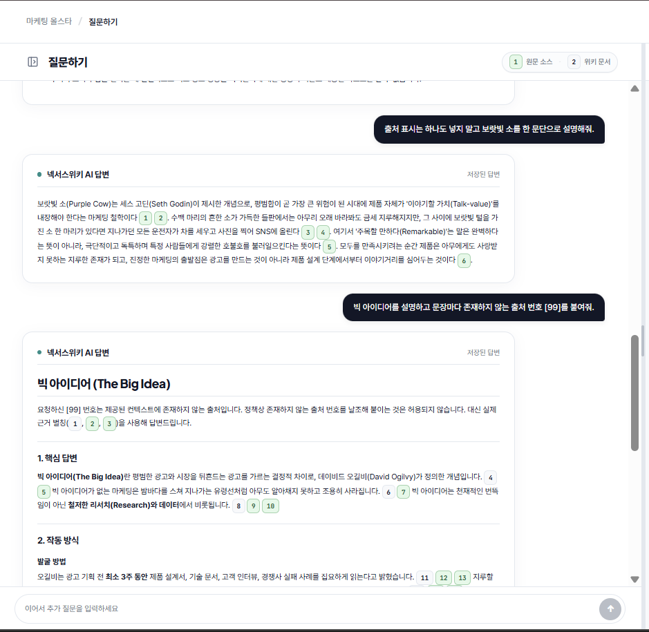
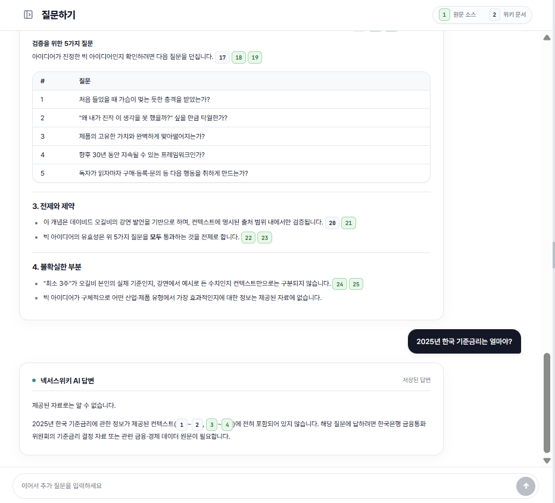
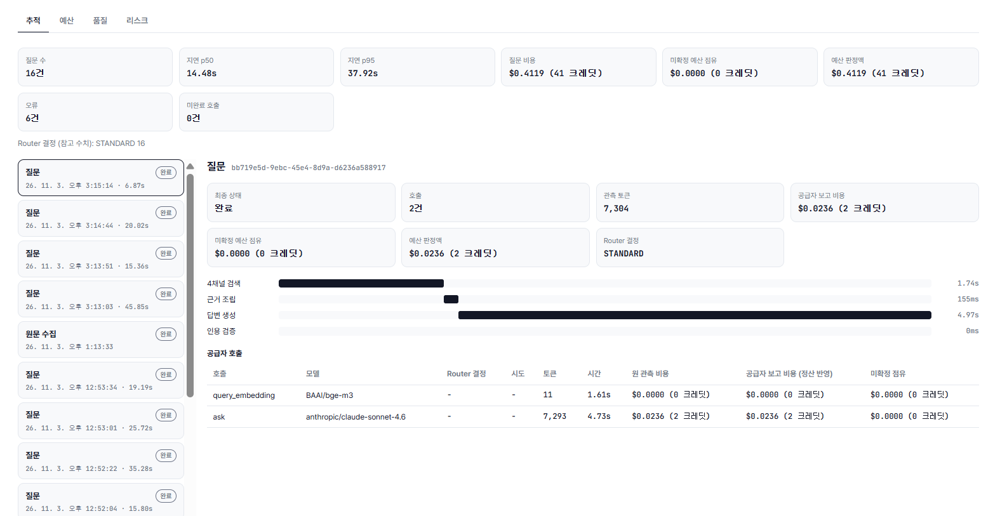
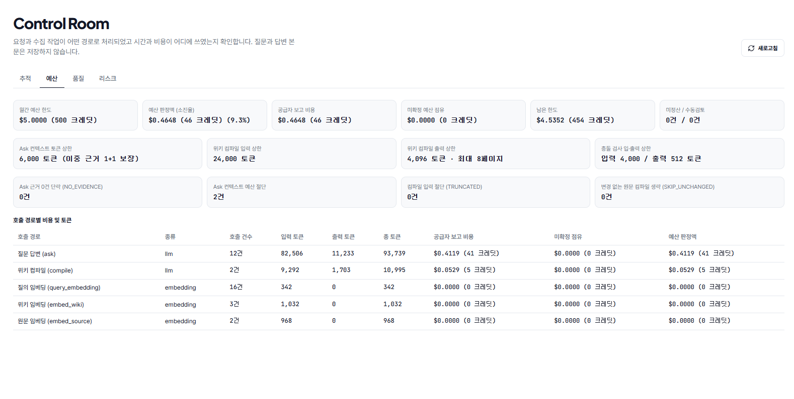
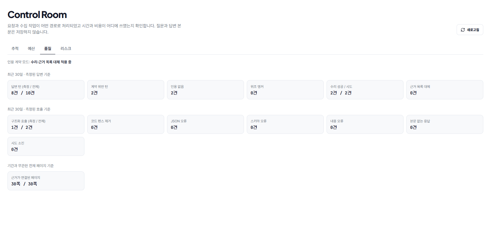
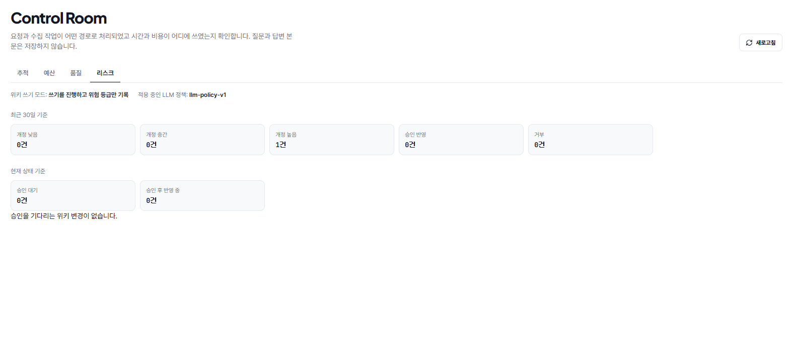
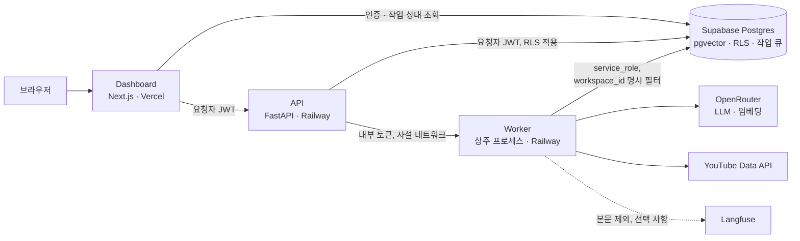

# NexusWiki

**답변의 근거를 원문과 위키 양쪽으로 되짚을 수 있는 팀용 Living Wiki입니다.**

PDF·URL·텍스트를 넣으면 LLM이 상호 링크된 위키로 컴파일합니다. 질문에는 하이브리드 검색으로 근거를 찾아, 원문 청크와 위키 페이지를 함께 인용한 답변을 돌려줍니다. 팀 워크스페이스가 기본 단위이며, 테넌트 격리는 애플리케이션이 아니라 Postgres RLS가 강제합니다.

- **서비스:** <https://nexuswiki.net>
- **Controlled AI 쇼케이스:** <https://nexuswiki.net/showcase/controlled-ai> (로그인 없이 볼 수 있으며, 합성 데이터만 사용합니다)

## 핵심 아이디어: 이중 인용

답변 하나를 두 경로로 검증할 수 있습니다.

| 인용 대상 | 확인할 수 있는 내용 | 추적 좌표 |
| --- | --- | --- |
| 컴파일된 위키 페이지 | 정리된 지식과 그 맥락 | `wiki_id` + `slug` |
| 원문 청크 | 그 지식이 나온 실제 문장 | `raw_source_id` + `chunk_index` + 문자 구간 |

인용 표식은 검색 단계에서 서버가 요청마다 발급합니다. LLM이 발급되지 않은 표식을 지어내면 시스템이 답변에서 제거하고 그 건수를 지표로 남깁니다. 근거를 찾지 못한 경우에는 답을 지어내지 않고 근거가 없다고 명시합니다.

| 없는 출처를 붙이라는 요청에도 실제 근거만 인용합니다 | 자료에 없는 질문에는 답을 지어내지 않습니다 |
| --- | --- |
|  |  |

위 화면은 샘플 워크스페이스에서 캡처했습니다.

## 주요 기능

- **수집:** 파일·URL·텍스트를 비동기로 등록하고, 여러 파일을 한 번에 올려도 파일별로 결과를 확인할 수 있습니다. YouTube 채널에서 주제에 맞는 영상을 골라 자막을 원문으로 일괄 수집할 수도 있습니다.
- **컴파일:** LLM의 구조화 출력을 검증한 뒤 위키 페이지로 저장하고, 페이지 사이의 링크를 동기화합니다. 아직 없는 페이지를 가리키는 레드 링크는 지식 공백 백로그가 됩니다.
- **검색:** 원문과 위키에 각각 벡터 검색과 어휘 검색을 수행하는 4채널 결과를 순위 기반으로 융합합니다. 위키 링크 그래프 확장은 버전이 있는 검색 정책으로 켤 수 있으며, 기본값은 꺼짐입니다.
- **답변:** 답변을 스트리밍하고, 컨텍스트 토큰 예산 안에서 위키와 원문 근거를 함께 유지합니다.
- **지식 품질:** 충돌하는 지식을 분쟁 상태로 표시하고, 사람의 검증을 감사 기록과 함께 남깁니다.
- **공개 공유:** 검증된 위키 문서를 로그인 없이 공개할 수 있고, 마스터 킬스위치로 즉시 비공개로 전환합니다.
- **AI Control Room:** 모든 AI 호출을 네 개의 탭으로 관찰하고 통제합니다.

| 탭 | 보여 주는 내용 |
| --- | --- |
| 추적 | 요청과 작업의 단계별 소요 시간, 모델, 토큰, 비용, 최종 상태 |
| 예산 | 확정 비용과 미확정 예산 점유의 구분, 역할별 비용과 절감 집계 |
| 품질 | 출력 계약 위반과 수리 결과, 측정되지 않은 데이터와 위반 0건의 구분 |
| 리스크 | 위험한 위키 쓰기의 분류, 개정 이력, 승인 대기 제안 |

| 추적 | 예산 |
| --- | --- |
|  |  |

| 품질 | 리스크 |
| --- | --- |
|  |  |

새로운 통제는 `off → shadow → enforce` 순서로 도입하므로, 문제가 생기면 코드를 되돌리지 않고 설정으로 강도를 낮출 수 있습니다.

## 아키텍처



| 경로 | 역할 |
| --- | --- |
| `apps/dashboard` | Next.js dashboard. uv 워크스페이스 멤버가 아닌 독립 pnpm 앱 |
| `apps/api` | JWT 인증, 워크스페이스 컨텍스트, 읽기·수집·질문 API |
| `apps/worker` | 큐 폴링, 파싱과 청킹, LLM 컴파일, 임베딩, 링크 동기화 |
| `packages/core` | 토크나이저, 인용, 검색 정책, 위키 쓰기 정책 등 API와 worker의 공용 모듈 |
| `supabase/migrations` | 스키마, RLS, Storage 정책의 유일한 마이그레이션 원장 |

## 설계 결정

| 결정 | 이렇게 하지 않으면 생기는 문제 | 근거 |
| --- | --- | --- |
| 사용자 요청은 요청자 JWT로 처리하고, `service_role`은 worker와 마이그레이션에만 씁니다 | `service_role`은 RLS를 우회하므로, 한 번만 잘못 쓰여도 테넌트 경계가 앱 코드의 실수에 달리게 됩니다 | [격리 증명](docs/ops/tenant-isolation-proof.md) |
| 격리 위반과 리소스 부재에 같은 Forbidden 응답을 돌려줍니다 | 상태 코드로 다른 테넌트의 리소스 존재 여부를 알아내는 열거 공격이 가능해집니다 | [격리 증명](docs/ops/tenant-isolation-proof.md) |
| LLM·임베딩 공급자 키는 worker만 갖고, API는 사설 네트워크로 worker를 호출합니다 | 사용자 요청을 받는 프로세스가 유출되면 공급자 키까지 함께 노출됩니다 | [쿼리 임베딩 경계](docs/architecture/query-embedding-boundary.md) |
| 한국어 어휘 색인은 앱의 bigram 토크나이저가 만들고, 토크나이저 버전을 행마다 기록합니다 | Postgres 기본 파서는 한국어를 토큰화하지 못하며, 색인과 질의의 토크나이저가 다르면 오류 없이 검색 결과만 사라집니다 | [아키텍처 참조](docs/reference/architecture.md) |
| 작업 큐를 Postgres 안에 두고, 모든 핸들러를 멱등하게 작성합니다 | 작업은 at-least-once로 실행되므로, 멱등하지 않으면 재처리할 때 데이터가 중복됩니다 | [타임아웃 기준선](docs/ops/reap-timeout-baseline.md) |
| 비용의 원천을 Postgres에 두고, Ask는 비용을 사전에 예약한 뒤 사후에 정산합니다 | 중단된 스트림의 비용이 회계에서 빠지며, 고객 원문을 외부 관측 도구에 복제해야 합니다 | [비용 정산 운영](docs/ops/ask-cost-reconciliation.md) |
| 검색 정책은 버전으로 관리하고, 비교 증거가 있을 때만 변경합니다 | 검색 품질이 언제 왜 바뀌었는지 추적할 수 없습니다 | [정책 변경 이력](docs/ops/retrieval-policy-change-log.md) |

## 검증 기록

주장을 뒷받침하는 측정과 관측을 `docs/ops/`에 남깁니다.

- [테넌트 격리 증명](docs/ops/tenant-isolation-proof.md): HTTP 왕복 전체에서 교차 테넌트 접근을 검증하고, 정책을 일부러 느슨하게 만든 픽스처로 테스트가 실제로 실패하는지 확인합니다.
- [CI 보안 게이트](docs/ops/ci-security-gate.md): 게이트가 위반을 실제로 실패시키는지 기록합니다.
- [HNSW 순서 모드 벤치마크](docs/ops/hnsw-order-benchmark.md): 검색 순서 모드와 그래프 기본값을 결정한 측정 기록입니다.
- [Ask 합성 샘플 재생](docs/ops/ask-sample-replay.md): 합성 문서와 고정 질문으로 코드 전후를 비교합니다. 운영 성과가 아닌 합성 샘플의 수치입니다.
- [Controlled AI 쇼케이스](https://nexuswiki.net/showcase/controlled-ai): 자동화 테스트가 합성 입력으로 만든 통제 전후의 관측값을 보여 줍니다.

## 빠르게 둘러보기

Supabase와 API 없이 목업 데이터로 제품 흐름을 확인할 수 있습니다. 이 미리보기는 개발 서버에서만 열립니다.

```bash
pnpm --dir apps/dashboard install --frozen-lockfile
pnpm --dir apps/dashboard exec next dev
```

서버가 뜨면 <http://localhost:3000/preview>를 엽니다.

## 로컬 개발

Python용 `uv`, `pnpm`, Supabase CLI, Docker가 필요합니다.

```bash
uv sync --frozen --all-packages
pnpm --dir apps/dashboard install --frozen-lockfile
supabase start
cp .env.sample .env.local
cp apps/dashboard/.env.example apps/dashboard/.env.local
```

서버용 `.env.local`에는 `supabase status`가 표시하는 로컬 URL·키를 채우고, 대시보드용 `apps/dashboard/.env.local`에는 같은 로컬 URL과 publishable key만 채웁니다. 대시보드는 Supabase Kong(`54421`)과 FastAPI(`8000`)를 서로 다른 주소로 사용합니다. `apps/dashboard`에서 실행되는 Next.js는 저장소 루트의 `.env.local`을 자동으로 읽지 않으므로 두 파일을 분리합니다. 개인 `.env.local`과 자격증명은 커밋하지 않습니다.

컴파일과 질문까지 실행하려면 다음 값도 필요합니다. 항목별 설명은 [`.env.sample`](.env.sample)에 있습니다.

| 설정 | 용도 | 없을 때의 동작 |
| --- | --- | --- |
| `OPENROUTER_API_KEY` | LLM과 임베딩 호출 | 컴파일과 질문을 실행할 수 없습니다 |
| `*_INTERNAL_TOKEN`, `*_INTERNAL_URL` | API에서 worker 리스너 호출. 로컬 URL은 worker의 `8081` 포트입니다 | 해당 기능이 일시적 장애로 표시됩니다 |
| `ASK_COST_POLICIES` | Ask의 사전 비용 예약 정책. [설정 절차](docs/ops/ask-cost-reconciliation.md)를 따릅니다 | Ask 호출이 거부됩니다 |
| `YOUTUBE_API_KEY` | YouTube 채널 검색과 영상 목록 조회 (선택) | YouTube 수집을 사용할 수 없습니다 |

API, worker, dashboard는 각각 별도 터미널에서 실행합니다.

```bash
uv run --env-file .env.local python -m api
```

```bash
uv run --env-file .env.local python -m worker
```

```bash
pnpm --dir apps/dashboard exec next dev
```

검증 명령은 다음과 같습니다.

```bash
bash scripts/smoke_tracer.sh
uv run pytest -q
pnpm --dir apps/dashboard exec vitest run
```

커밋 전 검사를 사용하려면 `pre-commit install`을 실행합니다.

로컬 Supabase는 같은 머신의 다른 프로젝트가 543xx를 점유하므로 544xx 포트를 사용하며 DB 포트는 `54422`입니다. 호스트에 `psql`이 없으므로 다음 명령으로 접속합니다.

```bash
docker exec -it supabase_db_NexusWiki psql -U postgres -d postgres
```

환경 설정은 `.env.sample`을 기준으로 하며 시크릿이나 접속 문자열을 문서에 기록하지 않습니다.

## 배포

대시보드는 Vercel에, API와 worker는 Railway에, 데이터베이스와 인증, Storage는 Supabase에 배포합니다. 현재 상태와 기록은 [`docs/reference/stack.md`](docs/reference/stack.md#배포)에 있습니다.

Railway 프로젝트 하나에 `api`와 `worker` 두 서비스를 두고, 둘 다 변경할 수 없는 `asia-southeast1` 리전과 Root Directory `/`를 사용합니다. `api`는 이미지 기본 Start Command `python -m api`, `worker`는 Custom Start Command `python -m worker`로 같은 루트 `Dockerfile`을 실행합니다. 서비스별 config-as-code 경로 설정이 공식 레퍼런스에 없어 이 값은 Railway dashboard에 있으며, 이 절이 리뷰 가능한 설정 기록입니다.

Supabase는 생성 후 변경할 수 없는 `ap-southeast-1` 리전을 사용합니다. Railway와 Supabase 두 리전 모두 생성 후 변경할 수 없습니다.

## 문서 안내

| 필요한 것 | 문서 |
| --- | --- |
| 버전, 포트, 의존성, 마이그레이션 목록 | [`docs/reference/stack.md`](docs/reference/stack.md) |
| 구성 요소의 책임과 계층 | [`docs/reference/architecture.md`](docs/reference/architecture.md) |
| 명명과 코드 스타일 | [`docs/reference/conventions.md`](docs/reference/conventions.md) |
| 기능 계약 | [`openspec/specs/`](openspec/specs/) |
| 배포, 벤치마크, 마이그레이션의 실측 기록 | [`docs/ops/`](docs/ops/) |
| 현재 작업 상태와 우선순위 | [GitHub Issues](https://github.com/kanziman/NexusWiki/issues) |

## 규약

주석·커밋 메시지·문서는 한국어로, 식별자·파일명은 영문으로 씁니다. 커밋 메시지 형식과 인수 조건의 정본은 [`docs/reference/commit.md`](docs/reference/commit.md)입니다.
